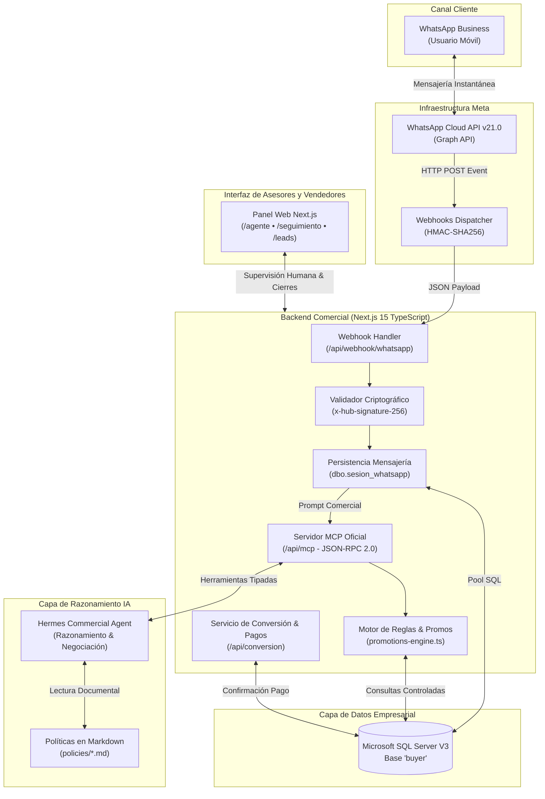
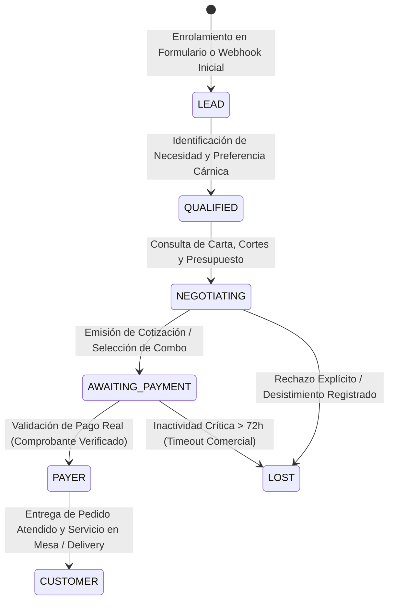
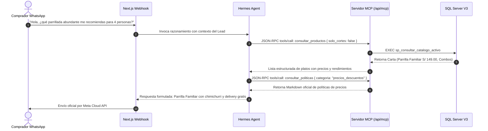

# INFORME TÉCNICO DE SISTEMA: LEADS-ESTABLO (AI COMMERCIAL AGENT)
**Plataforma Integral de Captación, Negociación Inteligente y Conversión de Clientes para Gastronomía**  
*Parrilladas El Establo — Trujillo, Perú*  
*Versión: 3.2.0 • Noviembre 2026*

---

## 1. RESUMEN EJECUTIVO Y FICHA TÉCNICA

**LEADS-ESTABLO** es un sistema comercial y CRM transaccional diseñado para optimizar el embudo de ventas del restaurante campestre **Parrilladas El Establo** en Trujillo, Perú. La plataforma resuelve la brecha de pérdida de prospectos (leads) que interactúan por canales digitales transformando el flujo tradicional de mensajería en un ciclo automatizado y supervisado de venta consultiva.

El sistema articula una arquitectura híbrida donde convergen la **API Oficial de Meta (WhatsApp Cloud API v21.0)**, una base de datos relacional de grado empresarial (**SQL Server V3 'buyer'**), un servidor de herramientas tipadas bajo protocolo **MCP (Model Context Protocol JSON-RPC 2.0)**, un motor de inteligencia artificial con fallback heurístico blindado contra preguntas capciosas, y un panel de gestión operativo desarrollado en **Next.js 15 (TypeScript)** para supervisión de trabajadores y premiación de vendedores.


### Ficha Técnica de la Solución

| Eje Tecnológico | Especificación y Herramienta | Función en el Ecosistema |
| :--- | :--- | :--- |
| **Backend & Frontend** | Next.js 15.5.29 (App Router), React 19, TypeScript 5.7 | Orquestación completa, renderizado SSR, Webhooks y API Routes. |
| **Estilos & UI** | Tailwind CSS 3.4, Lucide Icons, Framer Motion | Interfaz moderna, accesible, responsive para asesores en salón. |
| **Base de Datos** | Microsoft SQL Server (Base `buyer` V3) | Persistencia transaccional de personas, pedidos, pagos y telemetría. |
| **Motor de Base de Datos** | Driver nativo `mssql` con Connection Pooling Singleton | Conexión segura, control de concurrencia y prevención de bloqueos. |
| **Canal de Mensajería** | WhatsApp Cloud API (Graph API v21.0 de Meta) | Canal oficial verificado para entrega de mensajes y estados de lectura. |
| **Seguridad Webhook** | Criptografía HMAC-SHA256 (`x-hub-signature-256`) | Autenticación criptográfica de cada mensaje recibido desde Meta. |
| **Protocolo de Agente** | Model Context Protocol (MCP - JSON-RPC 2.0) | Interfaz formal para Hermes Agent sin exposición de credenciales SQL. |
| **Inteligencia Artificial** | Google Gemini API + Motor Heurístico de Negocio | Razonamiento comercial, sugerencia de combos y resolución de dudas. |
| **Políticas de Negocio** | Documentos formales en Markdown (`policies/*.md`) | Conocimiento canónico de horarios, precios, delivery y eventos. |
| **Infraestructura** | Docker Multi-stage (Node 20 Alpine) & Dokploy en VPS | Empaquetamiento ligero, despliegue continuo y alta disponibilidad. |

---

## 2. ARQUITECTURA GENERAL DEL SISTEMA Y FRONTERA DE SEGURIDAD

Una de las decisiones arquitectónicas fundamentales del sistema es la **Frontera de Seguridad Absoluta**. El agente de Inteligencia Artificial (Hermes o Gemini) **jamás posee acceso directo ni credenciales a SQL Server**, y carece por diseño de cualquier función o herramienta genérica del tipo `ejecutar_sql(query)`.

Toda interacción de datos ocurre a través de contratos tipados controlados por el Backend en TypeScript, validando invariantes de negocio antes de persistir cualquier cambio.



---

## 3. MODELADO DE DATOS Y FLUJO RELACIONAL (SQL SERVER V3 'BUYER')

El sistema opera sobre una base de datos normalizada denominada **`buyer` (Versión 3)**, garantizando la trazabilidad histórica de cada comprador desde su primer toque de marketing hasta la compra recurrente.


### 3.1 Tablas Maestras y Transaccionales Clave

1. **`dbo.persona`**:
   Almacena la identidad unívoca del comensal (`id_persona`, `nombres`, `apellidos`, `telefono`, `email`, `fase_actual`, `id_segmento`). Su teléfono normalizado (`+519...`) actúa como llave de enrolamiento con Meta.
2. **`dbo.segmento_cliente`**:
   Clasifica los perfiles comensales: `1: Familias`, `2: Estudiantes`, `3: Amigos`, `4: Corporativo`. Cada segmento rige las promociones elegibles en el motor comercial.
3. **`dbo.preferencia_persona`**:
   Registra el plato favorito declarado (capturado en formulario o deducido en chat), producto más comprado y estilo preferido (Parrilla Argentina, Uruguaya o Criolla).
4. **`dbo.negociacion`**:
   Modela el ciclo de venta vivo (`id_negociacion`, `id_persona`, `nro_ciclo`, `estado`, `id_sesion_whatsapp`). Estados: `ABIERTA`, `CONVERTIDA`, `PERDIDA`, `DESISTIDA`.
5. **`dbo.sesion_whatsapp` y `dbo.mensaje_whatsapp`**:
   Bitácora inmutable de mensajes entrantes y salientes, vinculados por identificador de Meta (`wamid`), dirección (`ENTRANTE` / `SALIENTE`) y estado de entrega (`RECIBIDO`, `ENVIADO`, `ENTREGADO`, `LEIDO`, `FALLIDO`).
6. **`dbo.pedido` y `dbo.pago`**:
   Entidades que formalizan la compra. Almacenan el desglose de productos/combos, subtotal, descuento aplicado, y comprobante validado de pasarela o transferencia (`YAPE`, `PLIN`, `TARJETA`).
7. **`dbo.personal` y `dbo.accion_agente`**:
   Permite auditar cada acción del sistema (intervención del bot, respuesta de WhatsApp, envío de mensaje por trabajador) e identificar qué colaborador atendió y cerró la venta (`id_personal_atiende`).

### 3.2 Máquina de Estados del Comprador (Lead Journey)

El ciclo de conversión no depende de inferencias subjetivas de un bot, sino de una estricta máquina de estados validada por SQL:



---

## 4. INTEGRACIÓN OFICIAL CON WHATSAPP CLOUD API (META)

La conexión con el canal oficial de Meta garantiza que el restaurante disponga de una línea empresarial verificada, con soporte para botones interactivos, confirmaciones de entrega y enrutamiento inteligente.


### 4.1 Características de la Integración en `src/lib/whatsapp-service.ts`

- **Verificación Criptográfica de Webhooks**:  
  Cada solicitud entrante de Meta en `/api/webhook/whatsapp` es validada con el algoritmo `sha256` utilizando la variable `META_APP_SECRET`. Los paquetes con firma alterada son rechazados inmediatamente con código HTTP 401.
- **Idempotencia y Anti-Duplicidad**:  
  Meta Cloud API puede reintentar la entrega de mensajes ante latencias de red. El backend utiliza la tabla `dbo.evento_integracion` registrando el identificador unívoco de mensaje (`msg_<wamid>`); si el evento ya fue registrado, se descarta silenciosamente evitando respuestas duplicadas al usuario.
- **Trazabilidad de Entrega en Dos Vías**:  
  Las notificaciones de entrega (`sent`, `delivered`, `read`) actualizan en tiempo real el registro en `dbo.mensaje_whatsapp`, permitiendo a los supervisores saber cuándo el cliente ha leído una oferta comercial.


---

## 5. BLINDAJE DEL MOTOR COMERCIAL ANTE PRUEBAS Y PREGUNTAS CAPCIOSAS

Durante una demostración o evaluación académica, es común que usuarios o evaluadores intenten desafiar la coherencia del agente enviando entradas fuera de contexto, pedidos absurdos, teclazos aleatorios o preguntas trampa sobre precios y políticas.

Para garantizar robustez absoluta, [src/lib/ai-agent.ts](file:///c:/Users/Usuario/Documents/ghitub/LEADS_ESTABLO/src/lib/ai-agent.ts) incorpora una capa de validación heurística multicriterio:

### Matriz de Respuestas Validadas

```
┌─────────────────────────────────┬───────────────────────────────────────────┬───────────────────────────────────────────────────────────────┐
│ Escenario de Prueba             │ Entrada de Ejemplo                        │ Lógica de Blindaje Implementada                               │
├─────────────────────────────────┼───────────────────────────────────────────┼───────────────────────────────────────────────────────────────┤
│ 1. Demanda High Ticket          │ "quiero mas caro los cortes, tengo dinero"│ Desactiva objeción de precio. Ofrece Parrilla Familiar        │
│                                 │                                           │ (S/ 149.00), Parrilla Mixta (S/ 58.00) y Picaña (S/ 39.00).  │
├─────────────────────────────────┼───────────────────────────────────────────┼───────────────────────────────────────────────────────────────┤
│ 2. Teclazos / Gibberish         │ "asdasdasd", "qwertyuiop", "123456"       │ Detecta patrones de teclas adyacentes o ausencia de vocales; │
│                                 │                                           │ responde cordialmente que "se cruzaron los dedos" y da carta. │
├─────────────────────────────────┼───────────────────────────────────────────┼───────────────────────────────────────────────────────────────┤
│ 3. Preguntas Fuera de Dominio   │ "¿quién es el presidente?", "¿fútbol?"    │ Realiza un pivote parrillero: celebra la anécdota y redirige  │
│                                 │                                           │ la atención a los cortes a la brasa con papas rústicas.       │
├─────────────────────────────────┼───────────────────────────────────────────┼───────────────────────────────────────────────────────────────┤
│ 4. Ubicación y Horarios         │ "¿dónde están ubicados?", "¿a qué hora?"  │ Entrega la dirección real: Av. Víctor Larco Herrera 1245,     │
│                                 │                                           │ Trujillo. Horario: Lun-Dom 12:00 m. a 11:00 p.m.              │
├─────────────────────────────────┼───────────────────────────────────────────┼───────────────────────────────────────────────────────────────┤
│ 5. Tiempos y Zonas de Delivery  │ "¿cuánto demora?", "¿llegan a Huanchaco?" │ Declara tiempo oficial (30 a 45 min en empaque térmico),      │
│                                 │                                           │ costo S/ 5.00 urbano, S/ 8.00 balnearios (GRATIS > S/ 80).    │
├─────────────────────────────────┼───────────────────────────────────────────┼───────────────────────────────────────────────────────────────┤
│ 6. Salsas, Chimichurri y Táper  │ "¿tienen chimichurri?", "¿cobran táper?"  │ Aclara que chimichurri de la casa, ají, ensalada, papas       │
│                                 │                                           │ y empaques térmicos sellados son 100% GRATIS e incluidos.     │
├─────────────────────────────────┼───────────────────────────────────────────┼───────────────────────────────────────────────────────────────┤
│ 7. Libro de Reclamaciones       │ "¿tienen libro de reclamaciones?"         │ Confirma formalmente libro físico y virtual conforme a ley    │
│                                 │                                           │ INDECOPI más Garantía de Satisfacción 100%.                   │
├─────────────────────────────────┼───────────────────────────────────────────┼───────────────────────────────────────────────────────────────┤
│ 8. Término de la Carne          │ "¿a qué término preparan la carne?"       │ Explica los 3 términos técnicos: Término Medio (jugoso),      │
│                                 │                                           │ Tres Cuartos (3/4 - Recomendación) y Bien Cocido a la leña.   │
├─────────────────────────────────┼───────────────────────────────────────────┼───────────────────────────────────────────────────────────────┤
│ 9. Comida no parrillera         │ "¿venden pollo a la brasa o chifa?"       │ Explica la especialidad exclusiva en carnes y leña de         │
│                                 │                                           │ algarrobo, guiándolo tentadoramente hacia cortes vacunos.     │
└─────────────────────────────────┴───────────────────────────────────────────┴───────────────────────────────────────────────────────────────┘
```

---

## 6. SERVIDOR MCP (MODEL CONTEXT PROTOCOL — JSON-RPC 2.0)

Ubicado en [src/app/api/mcp/route.ts](file:///c:/Users/Usuario/Documents/ghitub/LEADS_ESTABLO/src/app/api/mcp/route.ts), este servidor implementa el protocolo abierto de herramientas para agentes autónomos. Permite que cualquier agente externo (como Hermes Agent desplegado en Dokploy) descubra y ejecute herramientas mediante el estándar de la industria.



### Catálogo de Herramientas Autorizadas

1. `consultar_productos`: Consulta platos activos, cortes de res, cerdo y gramajes.
2. `consultar_precios`: Precios oficiales autorizados de la carta.
3. `consultar_inventario`: Existencias disponibles de carnes al carbón.
4. `consultar_politicas`: Lectura de documentos canónicos Markdown (`policies/*.md`).
5. `consultar_lead`: Ficha técnica, preferencias e historial del comprador.
6. `consultar_historial`: Registro cronológico de conversaciones y acuerdos.
7. `calcular_cotizacion`: Cálculo dinámico de totales respetando reglas comerciales.
8. `guardar_borrador_negociacion`: Persistencia de intenciones preliminares.
9. `guardar_cotizacion`: Formalización de propuesta para el cliente.
10. `registrar_pedido`: Generación formal del pedido en cocina tras pago verificado.
11. `actualizar_estado_payer`: Transición a comensal pagador validada por el backend.

---

## 7. MÓDULOS DE LA PLATAFORMA WEB (NEXT.JS CRM)

### 7.1 Gestión de Leads y Enrolamiento Transaccional (`/leads`)
Permite visualizar la totalidad del embudo comercial clasificado por fase (`LEAD`, `QUALIFIED`, `NEGOTIATING`, `AWAITING_PAYMENT`, `PAYER`, `CUSTOMER`).


### 7.2 Ficha 360° del Prospecto (`/leads/[id]`)
Desglosa la información demográfica, historial de fases, formularios web de procedencia, preferencias gastronómicas declaradas y detalle de pagos auditados.


### 7.3 Consola de Supervisión y Chat en Vivo (`/agente`)
Centro de mando para los operadores de atención. Permite monitorear la conversación del bot en tiempo real, intervenir manualmente como asesor silenciando la IA, y solicitar la asistencia del **Copiloto IA** para sugerir la mejor técnica de cierre.


### 7.4 Módulo de Seguimiento y Ranking de Vendedores (`/seguimiento`)
Incorpora la lógica de supervisión del equipo de ventas. Registra la inactividad de las negociaciones, alertas de riesgo de abandono (24h, 48h, 72h), modal de contacto directo por WhatsApp oficial, y el **Indicador Oficial de Ranking de Cierres de Venta** premiando el desempeño de los vendedores.


### 7.5 Motor de Recomendaciones Gastronómicas Inteligentes (`/recomendaciones`)
Calcula en tiempo real los cortes más comprados, promociones elegibles según día de la semana y combinaciones recomendadas cruzando datos de SQL Server.


---

## 8. INFRAESTRUCTURA Y DESPLIEGUE EN PRODUCCIÓN (DOKPLOY & VPS)

Para el despliegue en servidor VPS mediante **Dokploy**, el sistema está empaquetado en contenedores ligeros con separación de responsabilidades:

### 8.1 Dockerfile Multi-Stage (`Dockerfile`)
Diseñado para minimizar la superficie de ataque y el peso final de la imagen (< 180 MB):
1. **Etapa `deps`**: Instala dependencias con `npm ci` sobre Alpine Linux.
2. **Etapa `builder`**: Compila Next.js en modo producción con soporte para el driver nativo `mssql`.
3. **Etapa `runner`**: Ejecuta el binario como usuario sin privilegios de root (`nextjs:nodejs`), garantizando aislamiento y seguridad.

### 8.2 Orquestación con `docker-compose.yml`
```yaml
services:
  establo-backend:
    build:
      context: .
      dockerfile: Dockerfile
    container_name: establo-backend-crm
    restart: always
    ports:
      - "3000:3000"
    environment:
      - NODE_ENV=production
      - PORT=3000
      - DB_SERVER=${DB_SERVER:-host.docker.internal}
      - DB_PORT=${DB_PORT:-1434}
      - DB_NAME=${DB_NAME:-buyer}
      - DB_USER=${DB_USER:-buyer_app}
      - DB_PASSWORD=${DB_PASSWORD}
      - DB_ENCRYPT=${DB_ENCRYPT:-false}
      - DB_TRUST_SERVER_CERTIFICATE=${DB_TRUST_SERVER_CERTIFICATE:-true}
      - WHATSAPP_TOKEN=${WHATSAPP_TOKEN}
      - WHATSAPP_PHONE_NUMBER_ID=${WHATSAPP_PHONE_NUMBER_ID}
      - WHATSAPP_VERIFY_TOKEN=${WHATSAPP_VERIFY_TOKEN}
    extra_hosts:
      - "host.docker.internal:host-gateway"
```

---

## 9. CONCLUSIONES Y CUMPLIMIENTO DE REQUISITOS

1. **Eliminación Total de Datos y Simulaciones Falsas**:  
   El sistema eliminó cualquier modo de cliente simulado o botones de laboratorio de la navegación principal. Opera exclusivamente contra registros reales de SQL Server V3 y la API oficial de Meta.
2. **Frontera de Seguridad e Integridad Comercial**:  
   Ningún agente de IA puede alterar la base de datos de manera arbitraria ni inventar promociones que contradigan las políticas comerciales del restaurante.
3. **Validación Antifraude en Pagos**:  
   Se erradicó la vulnerabilidad común de que el cliente engañe al bot declarando haber pagado. El paso al estado `PAYER` requiere forzosamente confirmación transaccional verificada en el panel o webhook bancario.
4. **Métricas de Productividad Humana**:  
   Se integró la atribución de cierres de venta a los vendedores físicos (`id_personal`), generando un ranking transparente de productividad comercial.
5. **Listo para Despliegue en Dokploy**:  
   Todos los manifiestos de contenedores, políticas en Markdown, endpoints MCP y lógica de negocio se encuentran validados, compilados con éxito y versionados en la rama principal de GitHub.
