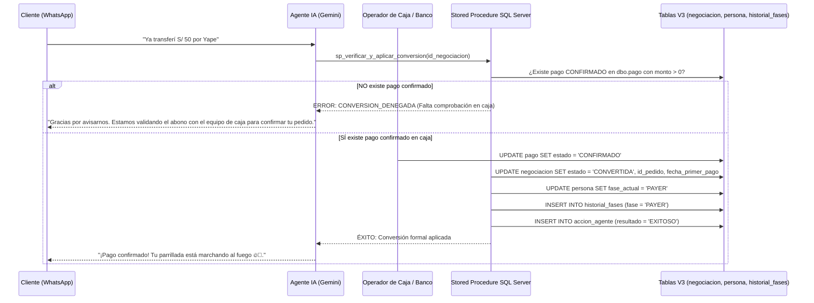

# MATRIZ TÉCNICA: MOTOR DE REGLAS DE NEGOCIO Y HERRAMIENTAS SQL (ESTABLO AI V3)

**Proyecto de Tesis:** *Diseño e implementación de un agente inteligente basado en inteligencia artificial para la conversión de LEADS en clientes mediante estrategias de venta personalizada.*  
**Base de Datos Oficial:** `buyer` (SQL Server V3 - 34 Tablas, 9 Vistas).  
**Principio de Seguridad Obligatorio:** **GEMINI NO EJECUTA SQL LIBRE.** El agente solo invoca herramientas controladas conectadas a procedimientos almacenados de mínimo privilegio.

---

## 1. MATRIZ DE HERRAMIENTAS Y PROCEDIMIENTOS ALMACENADOS

| # | Herramienta | Operación | Tabla o Vista | Procedimiento SQL | Nivel de Permiso | Regla Comercial Asociada |
|---|---|---|---|---|---|---|
| **C1** | `consultar_perfil_lead` | Lectura | `persona`, `segmento_cliente`, `vw_preferencias_persona`, `negociacion` | `dbo.sp_consultar_perfil_lead` | Consulta (Solo lectura) | **Aislamiento de Perfiles:** Solo consulta datos del LEAD autorizado en la conversación activa. |
| **C2** | `consultar_producto_favorito` | Lectura | `formulario_captacion`, `vw_preferencias_persona` | `dbo.sp_consultar_producto_favorito` | Consulta (Solo lectura) | **Diferenciación de Gustos:** Distingue preferencia declarada de compras reales en restaurante. |
| **C3** | `consultar_plato_mas_comprado` | Lectura | `pedido`, `pedido_detalle`, `producto_carta` | `dbo.sp_consultar_plato_mas_comprado` | Consulta (Solo lectura) | **Historial Transaccional:** Solo contabiliza pedidos no anulados; no inventa compras si es LEAD nuevo. |
| **C4** | `consultar_productos_populares_segmento` | Lectura | `vw_top_cortes_segmento`, `vw_top_combos_segmento` | `dbo.sp_consultar_productos_populares_segmento` | Consulta (Solo lectura) | **Segmentación Comercial:** Sugiere platos más vendidos según segmento (Familias, Amigos, Estudiantes). |
| **C5** | `consultar_promociones_mas_solicitadas` | Lectura | `promocion`, `oferta_negociacion`, `pedido` | `dbo.sp_consultar_promociones_mas_solicitadas` | Consulta (Solo lectura) | **Métricas Separadas:** Distingue promos ofrecidas, aceptadas y facturadas en pedidos. |
| **C6** | `consultar_promociones_elegibles` | Lectura | `vw_promos_vigentes` | `dbo.sp_consultar_promociones_elegibles` | Consulta (Solo lectura) | **Validación de Promos:** Valida día de semana en Perú (L..D), fecha inicio/fin y segmento objetivo. |
| **C7** | `consultar_peso_carne_frecuente` | Lectura | `producto_carta` (`peso_cantidad`, `peso_unidad`) | `dbo.sp_consultar_peso_carne_frecuente` | Consulta (Solo lectura) | **Gramajes Reales:** Usa pesos oficiales (350g, 150g, 1L). No infiere pesos ni inventa gramos. |
| **C8** | `consultar_productos_por_presupuesto` | Lectura | `producto_carta`, `combo` | `dbo.sp_consultar_productos_por_presupuesto` | Consulta (Solo lectura) | **Respeto de Presupuesto:** Filtra únicamente platos y combos con precio `<= presupuesto_maximo`. |
| **C9** | `consultar_historial_ofertas` | Lectura | `oferta_negociacion`, `producto_carta`, `combo`, `promocion` | `dbo.sp_consultar_historial_ofertas` | Consulta (Solo lectura) | **Evitar Saturación:** Revisa ofertas previas para no insistir con platos ya rechazados. |
| **C10** | `consultar_estado_conversion` | Lectura | `negociacion`, `pedido`, `pago` | `dbo.sp_consultar_estado_conversion` | Consulta (Solo lectura) | **Elegibilidad de Cierre:** Dictamina si existe un primer pago confirmado para proceder a PAYER. |
| **R1** | `registrar_preferencia_lead` | Escritura | `formulario_captacion`, `accion_agente` | `dbo.sp_registrar_preferencia_lead` | Registro Agente | **Preferencia Explícita:** Actualiza corte favorito sin borrar el historial transaccional previo. |
| **R2** | `registrar_necesidad_lead` | Escritura | `negociacion` (`resumen`), `accion_agente` | `dbo.sp_registrar_necesidad_lead` | Registro Agente | **Bitácora Comercial:** Registra número de comensales y presupuesto declarado sin alterar estructura. |
| **R3** | `registrar_objecion_lead` | Escritura | `accion_agente` | `dbo.sp_registrar_objecion_lead` | Registro Agente | **Clasificación de Objeciones:** Clasifica en PRECIO, PRESUPUESTO, INDECISION, TAMANO, PROMO, OTRA. |
| **R4** | `registrar_oferta_lead` | Escritura | `oferta_negociacion`, `accion_agente` | `dbo.sp_registrar_oferta_lead` | Registro Agente | **Cumplimiento CHECK:** Respeta `CK_oferta_objeto` (exactamente 1 objeto) y previene reintentos de webhook. |
| **R5** | `registrar_respuesta_oferta` | Escritura | `oferta_negociacion`, `accion_agente` | `dbo.sp_registrar_respuesta_oferta` | Registro Agente | **Registro de Interacción:** Actualiza estado a `ACEPTADA`, `RECHAZADA` o `SIN_RESPUESTA`. |
| **R6** | `registrar_accion_seguimiento` | Escritura | `accion_agente` (`id_personal = 1`) | `dbo.sp_registrar_accion_seguimiento` | Registro Agente | **Ventana de 72h:** Registra trazabilidad de contacto a las 24h, 48h o 72h. |
| **OP1** | `verificar_y_aplicar_conversion` | Transaccional Restringido | `negociacion`, `persona`, `historial_fases`, `pago`, `accion_agente` | `dbo.sp_verificar_y_aplicar_conversion` | **OPERACIÓN CRÍTICA (Requiere Pago Confirmado)** | **Conversión Estricta a PAYER:** Exige pago CONFIRMADO en `pago`. El agente IA NO puede registrar pagos. |

---

## 2. DIRECTIVAS DE SEGURIDAD Y GOBERNANZA

### ¿Qué puede consultar el agente?
* El perfil del LEAD con el que interactúa.
* El catálogo activo de platos (`producto_carta`), combos (`combo`) y sus gramajes oficiales (`peso_cantidad`, `peso_unidad`).
* Promociones vigentes que cumplan día y segmento en `vw_promos_vigentes`.
* Cortes y combos más solicitados dentro del segmento asignado.
* Historial de ofertas de la negociación actual.

### ¿Qué puede registrar el agente?
* Preferencias expresadas por el cliente en el chat.
* Presupuesto y número de personas comunicados por el cliente.
* Objeciones comerciales clasificadas.
* Ofertas presentadas y respuestas (`ACEPTADA`, `RECHAZADA`, `SIN_RESPUESTA`).
* Auditoría de seguimiento en `accion_agente` bajo `id_personal = 1` (*Agente Establo IA*).

### ¿Qué necesita autorización humana o proceso de caja?
* **Confirmación de pagos:** Un operador de caja o la pasarela bancaria debe marcar `pago.estado = 'CONFIRMADO'`.
* **Anulación o reembolso:** Modificación de pedidos o devoluciones monetarias.
* **Creación de nuevos platos o cambio de precios:** Competencia exclusiva de la administración del restaurante.

### ¿Qué operaciones están estrictamente prohibidas?
1. **Ejecutar sentencias SQL libres generadas por Gemini:** Ningún `INSERT`, `UPDATE`, `DELETE` arbitrario.
2. **Convertir a PAYER por texto:** Frases como *"Ya pagué"* o el envío de capturas por WhatsApp jamás activan la conversión de manera automática.
3. **Cruzar información entre clientes:** No revelar nombres, presupuestos ni datos de contacto de otros clientes.
4. **Inventar información:** Prohibido inventar porcentajes de descuento, productos fuera del menú o gramajes inexistentes.

---

## 3. MECANISMO DE VERIFICACIÓN DE CONVERSIÓN A PAYER

El procedimiento transaccional `dbo.sp_verificar_y_aplicar_conversion` ejecuta el siguiente flujo bajo `BEGIN TRANSACTION` con `XACT_ABORT ON`:

---

## 4. VALIDACIÓN DE EJECUCIÓN (RESULTADOS DE PRUEBA REALES)

* **Prueba de Consulta de Perfil:** `dbo.sp_consultar_perfil_lead(18, 20)` retorna cliente `Cristhian Alexis`, segmento `Amigos`, negociación `ABIERTA`.
* **Prueba de Gramajes Oficiales:** `dbo.sp_consultar_peso_carne_frecuente(3)` retorna `Picaña a la Parrilla (350 g)`, `Bife Ancho (350 g)`, `Chorizo (150 g)`.
* **Prueba de Prevención de Duplicados en Webhook:** `dbo.sp_registrar_oferta_lead` rechaza ofertas idénticas registradas en una ventana menor a 30 segundos.
* **Prueba de Bloqueo de Seguridad:** Intentar convertir la negociación #20 sin pago confirmado arrojó:
  > `[PASS SEGURIDAD EXITOSO] CONVERSION_DENEGADA: No existe ningun pago CONFIRMADO en SQL Server para esta negociacion. La palabra del cliente o una captura no constituyen pago oficial.`

