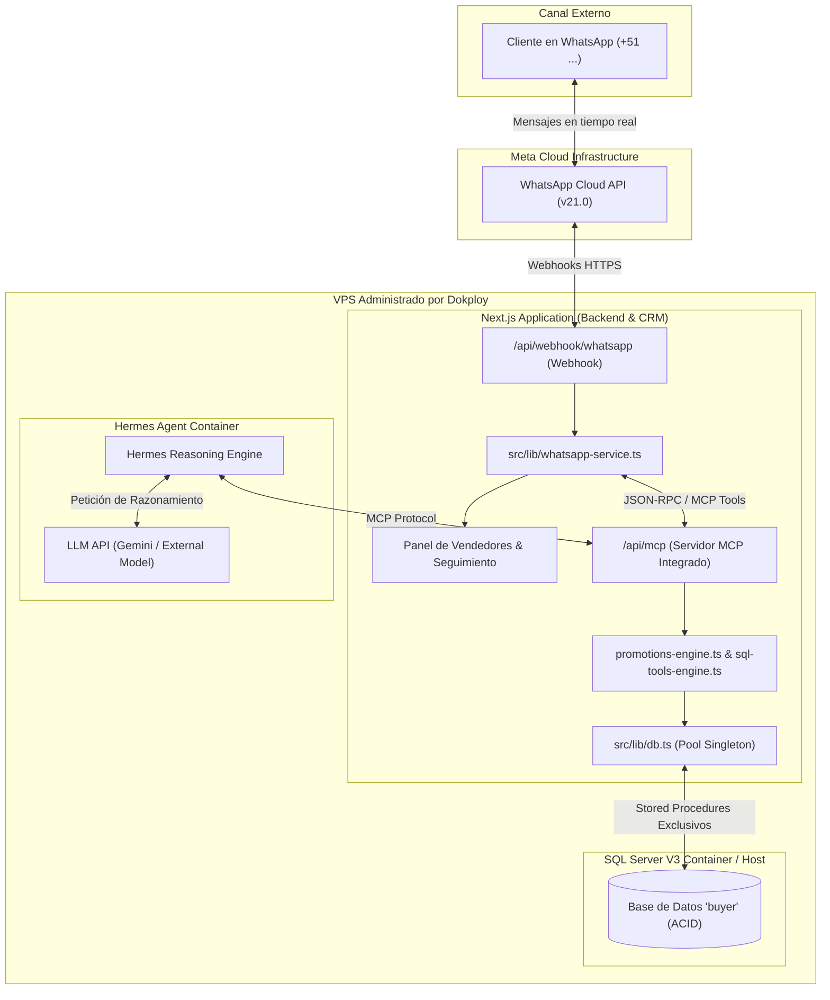
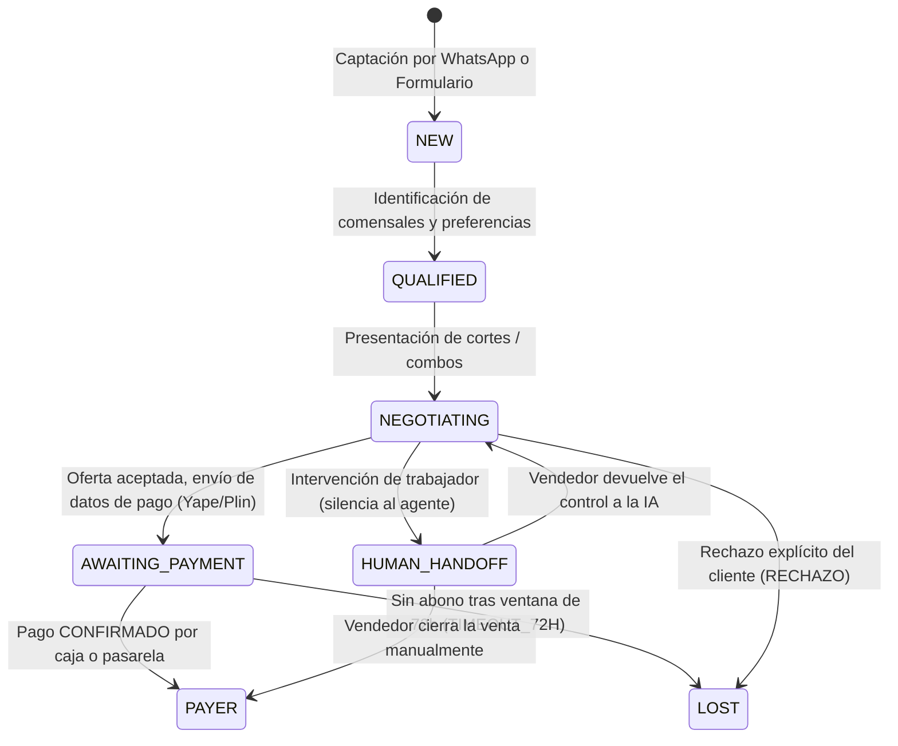

# Plan de Implementación Oficial: Agente Comercial con Hermes, WhatsApp y Dokploy

**Proyecto:** *Sistema Comercial Integrado y Agente Inteligente de Negociación (Parrilladas El Establo – Trujillo)*  
**Enfoque Arquitectónico:** *Backend Next.js como Frontera de Seguridad (Zero Arbitrary SQL) + Hermes Agent + WhatsApp Cloud API + Dokploy VPS*

---

## 1. Resumen Ejecutivo y Decisiones Clave

| Componente | Decisión Técnica | Justificación Comercial / Seguridad |
| :--- | :--- | :--- |
| **Canal de Comunicación** | WhatsApp Business Cloud API Oficial | Canal nativo y preferido por comensales en Trujillo; alta tasa de apertura y respuesta. |
| **Agente de Negociación** | Hermes Agent | Razonamiento comercial, argumentación persuasiva y toma de decisiones contextuales. |
| **Backend & Gobernanza** | Next.js 15 (TypeScript) | Frontera de seguridad infranqueable: orquesta webhooks, valida reglas y controla datos. |
| **Base de Datos** | SQL Server V3 (`buyer`) | 34 tablas y 9 vistas relacionales con procedimientos almacenados transaccionales (ACID). |
| **Protocolo de Herramientas** | Servidor MCP (Model Context Protocol) | Hermes solo accede a herramientas tipadas; **sin credenciales directas a SQL Server**. |
| **Políticas Comerciales** | Markdown (`policies/*.md`) + Reglas TS | Fuente de conocimiento para Hermes + validación dura en `promotions-engine.ts`. |
| **Control Humano (Takeover)** | `conversation_mode: 'AI' \| 'HUMAN'` | Si un vendedor o mesero interviene en el chat, el agente se silencia automáticamente. |
| **Conversión a PAYER** | Transacción condicionada a pago confirmado | Un lead no es cliente por decir *"ya pagué"*; exige abono validado en `dbo.pago`. |
| **Infraestructura** | VPS administrado con Dokploy | Despliegue con Docker Compose, variables de entorno aisladas y persistencia con volúmenes. |

---

## 2. Diagrama de Arquitectura y Frontera de Seguridad



---

## 3. Matriz de Herramientas MCP Autorizadas

Hermes **no tiene acceso a la cadena de conexión de SQL Server**. Solo invoca herramientas expuestas por el servidor MCP del backend:

### 3.1 Herramientas de Consulta (Lectura)
| Herramienta MCP | Entrada | Salida | Procedimiento SQL / Vista |
| :--- | :--- | :--- | :--- |
| `consultar_productos` | `solo_cortes: boolean` | Lista de cortes/platos con precio, gramaje y categoría | `dbo.producto_carta` |
| `consultar_precios` | `id_producto?: number, id_combo?: number` | Precios vigentes de venta | `dbo.producto_carta`, `dbo.combo` |
| `consultar_inventario` | `id_producto: number` | Disponibilidad operativa en cocina | `dbo.producto_carta.activo` |
| `consultar_politicas` | `categoria: string` | Reglas de delivery, horarios y promociones | `policies/*.md` + `promocion` |
| `consultar_lead` | `id_persona: number` | Ficha del lead, segmento y gustos registrados | `dbo.sp_consultar_perfil_lead` |
| `consultar_historial` | `id_persona: number` | Negociaciones y compras no anuladas | `dbo.sp_consultar_plato_mas_comprado` |
| `calcular_cotizacion` | `items: Array, id_segmento: number` | Subtotal, descuento legal y total calculado | `promotions-engine.ts` |

### 3.2 Herramientas de Mutación (Escritura Controlada)
| Herramienta MCP | Condición de Ejecución | Efecto en SQL Server |
| :--- | :--- | :--- |
| `guardar_borrador_negociacion` | Conversación activa identificada | Actualiza `dbo.negociacion.resumen` y `accion_agente`. |
| `guardar_cotizacion` | Cotización calculada por el backend | Registra oferta formal en `dbo.oferta_negociacion`. |
| `registrar_pedido` | Confirmación formal de la comanda | Inserta en `dbo.pedido` y `dbo.pedido_detalle`. |
| `actualizar_estado_payer` | **Solo si existe pago CONFIRMADO en caja** | Dispara `dbo.sp_verificar_y_aplicar_conversion`. |

---

## 4. Máquina de Estados del Lead y Verificación de Pago



---

## 5. Módulo de Atención al Cliente y Control de Intervención (Takeover)

1. **Bandeja Unificada de Mensajes:** Los mensajes entrantes de WhatsApp se almacenan en `dbo.mensaje_whatsapp` y aparecen en la consola del asesor.
2. **Control de Modo de Conversación (`conversation_mode`):**
   - `AI`: Hermes analiza y propone o responde directamente.
   - `HUMAN`: El agente IA queda silenciado. El trabajador responde directamente con el botón *Contactar (WhatsApp Real)*.
3. **Cierre por Vendedor & Ranking:** Si el asesor comercial cierra la venta en el local o por teléfono, registra la transacción asignándose el pedido (`id_personal_atiende`), lo que alimenta el ranking oficial de vendedores.

---

## 6. Arquitectura de Despliegue con Dokploy (Docker Compose)

### 6.1 `docker-compose.yml` Propuesto
```yaml
version: '3.8'

services:
  establo-backend:
    build:
      context: .
      dockerfile: Dockerfile
    container_name: establo_nextjs_app
    restart: always
    ports:
      - "3000:3000"
    environment:
      - NODE_ENV=production
      - DB_SERVER=sqlserver
      - DB_PORT=1433
      - DB_NAME=buyer
      - DB_USER=establo_app
      - DB_PASSWORD=${DB_PASSWORD}
      - WHATSAPP_ACCESS_TOKEN=${WHATSAPP_ACCESS_TOKEN}
      - WHATSAPP_PHONE_NUMBER_ID=${WHATSAPP_PHONE_NUMBER_ID}
      - WHATSAPP_VERIFY_TOKEN=${WHATSAPP_VERIFY_TOKEN}
      - GEMINI_API_KEY=${GEMINI_API_KEY}
    depends_on:
      - sqlserver

  sqlserver:
    image: mcr.microsoft.com/mssql/server:2022-latest
    container_name: establo_sqlserver_v3
    restart: always
    environment:
      - ACCEPT_EULA=Y
      - SA_PASSWORD=${DB_SA_PASSWORD}
    volumes:
      - sql_data:/var/opt/mssql

volumes:
  sql_data:
    driver: local
```

---

## 7. Plan de Ejecución por Fases

1. **Fase 1 (Completada):** Procedimientos Almacenados en SQL Server V3, tipado seguro TypeScript, guardrails de diálogo y WhatsApp Cloud API en vivo.
2. **Fase 2 (Completada):** Eliminación de modos simulados, envío de WhatsApp real por trabajadores en Seguimiento y Ranking de Cierres de Venta por Vendedor.
3. **Fase 3 (Siguiente):** Exposición del Endpoint MCP (`/api/mcp`) para conectar Hermes Agent mediante JSON-RPC / HTTP.
4. **Fase 4 (Siguiente):** Creación del directorio de políticas Markdown (`policies/`) y contenedor Docker para Dokploy.
