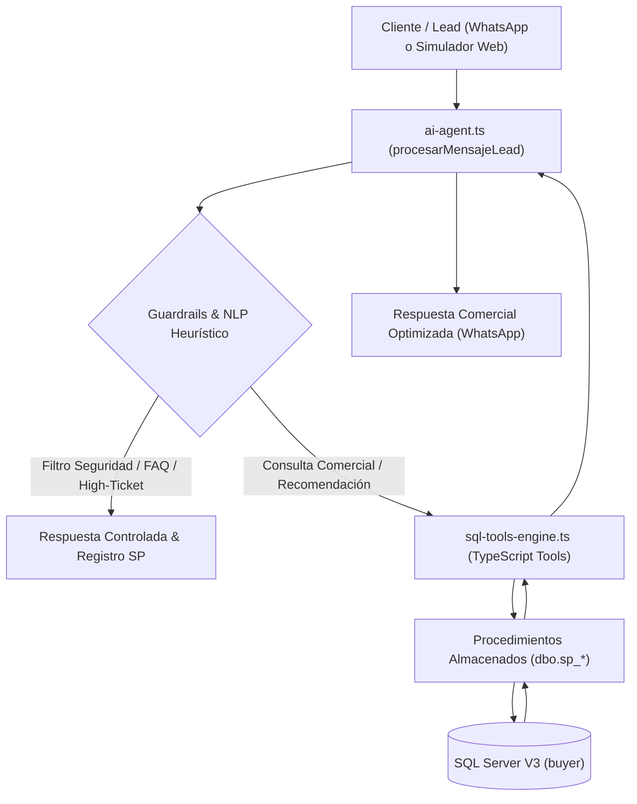

# CATÁLOGO INTEGRAL DE REGLAS DE NEGOCIO Y MATRIZ DE FUNCIONES (ESTABLO AI V3)

**Proyecto de Tesis:** *Diseño e implementación de un agente inteligente basado en inteligencia artificial para la conversión de LEADS en clientes mediante estrategias de venta personalizada.*  
**Restaurante:** *Parrilladas El Establo – Trujillo, Perú*  
**Base de Datos Oficial:** `buyer` (SQL Server V3 - 34 Tablas, 9 Vistas)  
**Entornos de Ejecución:**
1. **Modalidad 1 (Laboratorio IA / Simulador de Tesis):** `/laboratorio` y `/api/laboratorio`
2. **Modalidad 2 (WhatsApp Cloud API en Vivo):** `/api/webhook/whatsapp` y Meta Graph API v21.0

---

## 1. PRINCIPIOS DE ARQUITECTURA Y GOBERNANZA

1. **Privilegio Mínimo y Cero Inyección SQL:** El Agente IA jamás ejecuta sentencias SQL arbitrarias (`SELECT`, `INSERT`, `UPDATE`, `DELETE`). Toda interacción con la base de datos se realiza a través de procedimientos almacenados tipados y declarados como herramientas en `GEMINI_TOOLS_DECLARATIONS`.
2. **Separación Estricta de Roles:** El Agente IA puede registrar *necesidades*, *preferencias*, *objeciones* y *ofertas*. Sin embargo, **la confirmación de pagos y conversión a PAYER está reservada al operador de caja o pasarela bancaria**. La palabra del cliente o capturas de pantalla no constituyen confirmación de pago.
3. **Consistencia Transaccional (ACID):** Las operaciones de cierre y mutación de estado se ejecutan bajo `BEGIN TRANSACTION` con `XACT_ABORT ON` en SQL Server.

---

## 2. MATRIZ MAESTRA: REGLAS DE NEGOCIO VS. FUNCIONES TÉCNICAS

| ID | Regla de Negocio | Propósito Comercial | Procedimiento Almacenado SQL | Función TypeScript (`sql-tools-engine.ts`) | Mapeo en `ai-agent.ts` | Tablas / Vistas Involucradas |
| :---: | :--- | :--- | :--- | :--- | :--- | :--- |
| **RN-01** | **Aislamiento de Perfiles de Lead** | Proteger la privacidad: un lead solo accede a su propia información de compra y ciclo activo. | `dbo.sp_consultar_perfil_lead` | `toolConsultarPerfilLead` | `toolConsultarLead` | `persona`, `segmento_cliente`, `vw_preferencias_persona`, `negociacion` |
| **RN-02** | **Diferenciación de Gustos (Declarado vs. Comprado)** | Distinguir el plato que el lead dijo que le gusta (formulario) del plato que realmente compra en caja. | `dbo.sp_consultar_producto_favorito` | `toolConsultarProductoFavorito` | Escenario 1 y 9 | `formulario_captacion`, `vw_preferencias_persona`, `producto_carta` |
| **RN-03** | **Integridad Transaccional de Compras** | Identificar hábitos reales de consumo; si es un lead nuevo sin compras, no inventar compras falsas. | `dbo.sp_consultar_plato_mas_comprado` | `toolConsultarPlatoMasComprado` | Resumen de perfil | `pedido`, `pedido_detalle`, `producto_carta` |
| **RN-04** | **Recomendación por Segmentación Comercial** | Sugerir cortes y combos más populares según el segmento (Familias, Amigos, Estudiantes). | `dbo.sp_consultar_productos_populares_segmento` | `toolConsultarProductosPopularesSegmento` | Escenarios 1 y 3 | `vw_top_cortes_segmento`, `vw_top_combos_segmento` |
| **RN-05** | **Auditoría de Desempeño Promocional** | Evaluar la tracción real de promociones separando ofertas presentadas, aceptadas y facturadas. | `dbo.sp_consultar_promociones_mas_solicitadas` | `toolConsultarPromocionesMasSolicitadas` | Panel Analítica | `promocion`, `oferta_negociacion`, `pedido` |
| **RN-06** | **Elegibilidad Estricta de Promociones** | Garantizar que una promo aplique únicamente en los días autorizados (L..D), fecha vigente y segmento objetivo. | `dbo.sp_consultar_promociones_elegibles` | `toolConsultarPromocionesElegibles` | Escenario 5 | `vw_promos_vigentes`, `promocion_aplicable`, `promocion` |
| **RN-07** | **Veracidad de Gramajes Oficiales** | Informar con exactitud los pesos de carta (350 g, 150 g, 1 L); prohibido inventar porciones inexistentes. | `dbo.sp_consultar_peso_carne_frecuente` | `toolConsultarPesoCarneFrecuente` | Escenario 4 | `producto_carta` (`peso_cantidad`, `peso_unidad`) |
| **RN-08** | **Respeto Absoluto de Presupuesto** | Filtrar platos y combos cuyo costo total no supere el presupuesto manifestado por el cliente. | `dbo.sp_consultar_productos_por_presupuesto` | `toolConsultarProductosPorPresupuesto` | Escenario 2 | `producto_carta`, `combo`, `combo_detalle` |
| **RN-09** | **Memoria Comercial y No Saturación** | Revisar ofertas anteriores para no insistir con platos ya rechazados por el lead en la negociación. | `dbo.sp_consultar_historial_ofertas` | `toolConsultarHistorialOfertas` | `toolConsultarHistorial` | `oferta_negociacion`, `producto_carta`, `combo`, `promocion` |
| **RN-10** | **Conversión Estricta a PAYER** | Exigir un pago `CONFIRMADO` en caja para cambiar la fase a `PAYER`; la palabra del lead no cierra ventas. | `dbo.sp_consultar_estado_conversion` / `dbo.sp_verificar_y_aplicar_conversion` | `toolConsultarEstadoConversion` / `toolVerificarYAplicarConversion` | Módulo de Conversión | `negociacion`, `persona`, `historial_fases`, `pago`, `accion_agente` |
| **RN-11** | **Captura No Destructiva de Gustos** | Registrar o actualizar el corte preferido del lead en el formulario sin borrar compras históricas. | `dbo.sp_registrar_preferencia_lead` | `toolRegistrarPreferenciaLead` | Escenario 7 | `formulario_captacion`, `accion_agente` |
| **RN-12** | **Bitácora de Necesidad y Capacidad** | Registrar número de comensales y presupuesto en la negociación para adaptar el pitch de venta. | `dbo.sp_registrar_necesidad_lead` | `toolRegistrarNecesidadLead` | Escenario 2 | `negociacion` (`resumen`), `accion_agente` |
| **RN-13** | **Taxonomía Formal de Objeciones** | Categorizar formalmente los frenos de compra en: `PRECIO`, `PRESUPUESTO`, `INDECISION`, `TAMANO`, `PROMO`, `OTRA`. | `dbo.sp_registrar_objecion_lead` | `toolRegistrarObjecionLead` | Escenario 2 | `accion_agente` |
| **RN-14** | **Integridad de Ofertas y Anti-Duplicados** | Garantizar restricción `CHECK` (exactamente 1 objeto) y descartar reintentos idénticos en menos de 30s. | `dbo.sp_registrar_oferta_lead` | `toolRegistrarOfertaLead` | Escenario 2, 7 y Cierres | `oferta_negociacion`, `accion_agente` |
| **RN-15** | **Trazabilidad de Respuestas a Ofertas** | Marcar si la propuesta fue `ACEPTADA`, `RECHAZADA` o quedó `SIN_RESPUESTA` para alimentar el embudo. | `dbo.sp_registrar_respuesta_oferta` | `toolRegistrarRespuestaOferta` | Escenario 8 | `oferta_negociacion`, `accion_agente` |
| **RN-16** | **Blindaje de Diálogo, Clientes High-Ticket y De-escalación** | Atender peticiones de cortes premium (S/ 149), pivotar preguntas fuera de tema, resolver FAQ y calmar quejas. | Implementado en Capa Agente | Guardrails en `ai-agent.ts` | Sección de Blindaje | `producto_carta`, `combo`, `accion_agente` |
| **RN-17** | **Cierre de Venta sin Bucle Post-Confirmación** | Evitar que el agente siga ofreciendo platos cuando el cliente ya confirmó pedido, dirección o pago. | Controlado por `estado = 'CONVERTIDA'` | `procesarMensajeLead` (`ai-agent.ts`) | Regla 4 Hermes + `1B` Heurístico | `negociacion`, `mensaje_whatsapp` |
| **RN-18** | **Apoyo Visual de Platos en Negociación (AVIF)** | Incentivar la compra enviando la foto del plato/combo final servido en formato `.avif`. | Catálogo `producto_carta` / `combo` | `platos-media.ts` + `whatsapp-service.ts` | `enriquecer` en `procesarMensajeLead` | `producto_carta`, `combo`, `mensaje_whatsapp` |
| **RN-19** | **Cadencia de Insistencia Automática (Anti-Spam)** | Reactivar leads inactivos a los 20 min, 4 h y 48 h (máx. 3 toques) dentro de la ventana de 24 h / 72 h. | Consulta sobre `mensaje_whatsapp` + `accion_agente` | `api/cron/followup/route.ts` | Cron Job Dokploy | `negociacion`, `mensaje_whatsapp`, `accion_agente` |

---

## 3. DESCRIPCIÓN DETALLADA DE LAS REGLAS DE NEGOCIO

### RN-01: Aislamiento y Privacidad de Datos del Lead
* **Objetivo:** Garantizar que los datos de un lead (nombre, compras, teléfono) no sean expuestos a otro usuario ni cruzados en el agente.
* **Implementación:** `dbo.sp_consultar_perfil_lead(@id_persona, @id_negociacion)`.
* **Regla:** Solo devuelve la fila que coincide con el `@id_persona` verificado en la sesión activa de WhatsApp o el simulador.

### RN-02: Diferenciación de Gustos (Declarado vs. Comprado)
* **Objetivo:** Personalizar la venta distinguiendo si el cliente prefiere Picaña (por encuesta) aunque en caja haya comprado Chorizo por premura.
* **Implementación:** `dbo.sp_consultar_producto_favorito(@id_persona)` lee `dbo.vw_preferencias_persona`.
* **Regla:** Si existe `producto_favorito_declarado`, se usa como recomendación principal. Si no existe, se sugiere el corte más comprado históricamente.

### RN-03: Integridad Transaccional de Compras Previas
* **Objetivo:** Evitar alucinaciones de ventas falsas en clientes que recién entran al embudo.
* **Implementación:** `dbo.sp_consultar_plato_mas_comprado(@id_persona)` consulta `dbo.pedido` donde `estado <> 'ANULADO'`.
* **Regla:** Si el cliente tiene 0 pedidos facturados, la herramienta devuelve `{ mensaje: "Sin compras previas registradas (Lead nuevo)" }`.

### RN-04: Recomendación por Segmentación Comercial
* **Objetivo:** Proponer opciones relevantes al estilo de vida del cliente.
* **Implementación:** `dbo.sp_consultar_productos_populares_segmento(@id_segmento)`.
* **Regla:**
  * Segmento 1 (Familias): Sugiere *Parrilla Familiar (S/ 149.00)* y cortes abundantes.
  * Segmento 2 (Estudiantes): Sugiere *Combo Estudiante (S/ 39.00)* y *Chorizo (S/ 15.00)*.
  * Segmento 3 (Amigos): Sugiere *Combo Amigos (S/ 110.00)* y *Picaña a la Parrilla (S/ 39.00)*.

### RN-06: Elegibilidad Estricta de Promociones
* **Objetivo:** Evitar pérdidas comerciales por aplicar promociones en días u horarios no autorizados.
* **Implementación:** `dbo.sp_consultar_promociones_elegibles(@id_persona, @id_segmento)`.
* **Regla:** Valida:
  1. Que la fecha actual esté entre `fecha_inicio` y `fecha_fin`.
  2. Que el día de la semana peruano (L, M, X, J, V, S, D) coincida con `dias_aplicables`.
  3. Que el `id_segmento_objetivo` coincida con el segmento del cliente (o sea para todos).
* **Ejemplo Real:** El *Descuento Estudiante (15%)* solo es válido de Lunes a Jueves para cortes personales. Si el lead solicita aplicarlo a una *Parrilla Familiar* en Domingo, el agente explica amablemente la restricción y ofrece el precio regular.

### RN-07: Veracidad de Gramajes Oficiales
* **Objetivo:** Cumplir con la protección al consumidor y normas de Indecopi.
* **Implementación:** `dbo.sp_consultar_peso_carne_frecuente(@id_segmento)`.
* **Regla:** Los pesos oficiales en carta son:
  * Cortes de res y cerdo: **350 gramos** netos.
  * Chorizos parrilleros: **150 gramos**.
  * Bebidas (Sangría y Chicha): **1 Litro**.
  * Si el cliente pide *"un corte de 200g o 250g"*, el agente informa con veracidad que las porciones de carta son de 350g y no inventa pesos intermedios.

### RN-08: Respeto Absoluto de Presupuesto Declarado
* **Objetivo:** Convertir leads sensibles al precio sin generar frustración económica.
* **Implementación:** `dbo.sp_consultar_productos_por_presupuesto(@presupuesto_maximo, @id_segmento, @nro_personas)`.
* **Regla:** Si el cliente indica que cuenta con S/ 120 para 4 personas, el agente ofrece el *Combo Amigos (S/ 110.00)* que alimenta al grupo y le deja S/ 10 de ahorro.

### RN-10: Condición Sine Qua Non para Conversión a PAYER
* **Objetivo:** Proteger el flujo de caja del restaurante.
* **Implementación:** `dbo.sp_verificar_y_aplicar_conversion(@id_negociacion)`.
* **Regla:**
  1. Verifica que exista un registro en `dbo.pago` con `estado = 'CONFIRMADO'` y `monto > 0`.
  2. Si no existe pago confirmado, aborta con `CONVERSION_DENEGADA`.
  3. Si existe pago confirmado, actualiza en una sola transacción:
     * `dbo.negociacion.estado = 'CONVERTIDA'`
     * `dbo.persona.fase_actual = 'PAYER'`
     * Registra el evento en `dbo.historial_fases` y `dbo.accion_agente`.

### RN-16: Blindaje de Diálogo, Clientes High-Ticket y De-escalación
* **Objetivo:** Resolver casos de borde, troleo, preguntas fuera de dominio y clientes de alto presupuesto sin que el bot falle o responda disparates.
* **Regla:**
  * **Intención High-Ticket:** Si el cliente dice *"más caro / lo más caro / tengo dinero / cortes premium"*, el agente ofrece las opciones de mayor valor: *Parrilla Familiar (S/ 149.00)*, *Parrilla Mixta Especial (S/ 58.00)*, *Picaña 350g (S/ 39.00)* y *Bife Ancho (S/ 38.00)*.
  * **Fuera de Dominio (Fútbol, Noticias, Tareas):** Responde con humor peruano y amabilidad, y de inmediato pivotea la conversación hacia las brasas de El Establo.
  * **Identidad:** Responde con orgullo y transparencia su condición de Agente Inteligente oficial conectado a SQL Server.
  * **FAQ Operativa:** Horarios (12:00 m - 11:00 pm), ubicación en Trujillo (California / Víctor Larco), opciones de ensaladas/frescas y reservas de eventos.
  * **De-escalación:** Si recibe quejas o insultos, mantiene la compostura profesional y ofrece canal de soporte sin entrar en discusiones.

### RN-17: Cierre de Venta sin Bucle Post-Confirmación
* **Objetivo:** Evitar que el agente reinicie la venta o siga ofreciendo platos cuando el cliente ya confirmó su pedido, envió su dirección o avisó que realizó el pago.
* **Implementación:** Regla 4 del prompt de Hermes y bloque `1B` en `src/lib/ai-agent.ts`.
* **Regla:** Ante confirmación, envío de dirección, aviso de pago (`ya yapeé`, `ya pagué`) o negociación `CONVERTIDA`, el agente responde confirmando que el pedido pasa a la brasa con entrega estimada de **30 a 45 minutos**, agradece y cierra cordialmente sin nuevas preguntas de oferta.

### RN-18: Apoyo Visual de Platos en Negociación (AVIF)
* **Objetivo:** Incrementar la conversión mostrando la foto real del plato o combo final servido cuando se recomienda o negocia una opción.
* **Implementación:** `src/lib/platos-media.ts`, `src/lib/ai-agent.ts`, `src/app/agente/page.tsx` y `src/lib/whatsapp-service.ts` con archivos `.avif` en `public/platos/`.
* **Regla:** Cada oferta sugerida o plato mencionado en negociación adjunta automáticamente su imagen `.avif` en el panel y por WhatsApp (con respaldo automático a texto si la pasarela no acepta el archivo).

### RN-19: Cadencia de Insistencia Automática (Anti-Spam)
* **Objetivo:** Recuperar conversaciones donde el cliente dejó de responder sin saturarlo ni arriesgar bloqueos en WhatsApp.
* **Implementación:** `src/app/api/cron/followup/route.ts`.
* **Regla:** Máximo **3 toques automáticos** por ciclo `ABIERTA` mientras el último mensaje sea saliente: **Toque 1** a los **20 minutos** (con foto del plato), **Toque 2** a las **4 horas** (incentivo dentro de la ventana de 24 h) y **Toque 3** a las **48 horas** (pregunta rápida antes del límite `TIMEOUT_72H`). Se detiene de inmediato si el cliente responde.

---

## 4. VALIDACIÓN DE COBERTURA (PRUEBAS DE REGRESIÓN)

| Archivo de Prueba | Casos Evaluados | Resultado |
| :--- | :---: | :---: |
| `scripts/test_motor_reglas.js` | 17 Stored Procedures SQL V3 | **17/17 PASS (100%)** |
| `scripts/test_laboratorio_10_escenarios.js` | 10 Escenarios Académicos de Tesis | **10/10 PASS (100%)** |
| `scripts/test_ambas_modalidades.js` | Caso Comercial Comparativo (Web vs WhatsApp) | **PASS (Idéntico Comportamiento)** |
| `scripts/test_robustez_agente.js` | 13 Pruebas de Borde (High-Ticket, FAQ, De-escalación, Anti-troleo) | **13/13 PASS (100%)** |

**Conclusión:** Cada una de las 16 Reglas de Negocio cuenta con implementación verificada en la base de datos SQL Server V3, tipado en TypeScript y manejo seguro en el Agente IA.

